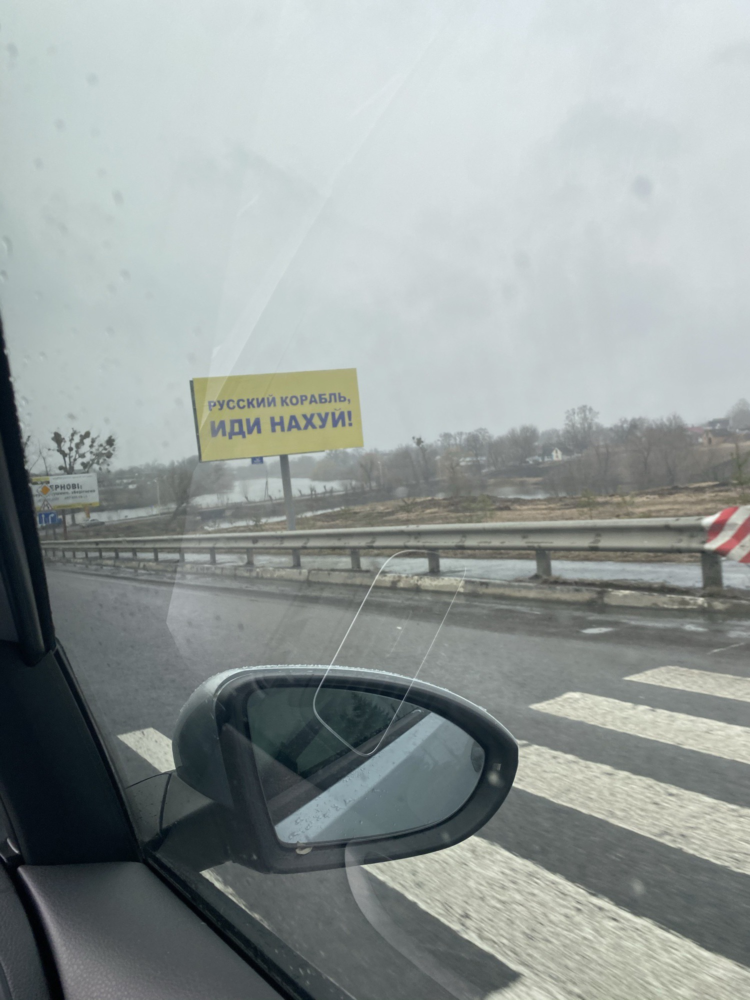
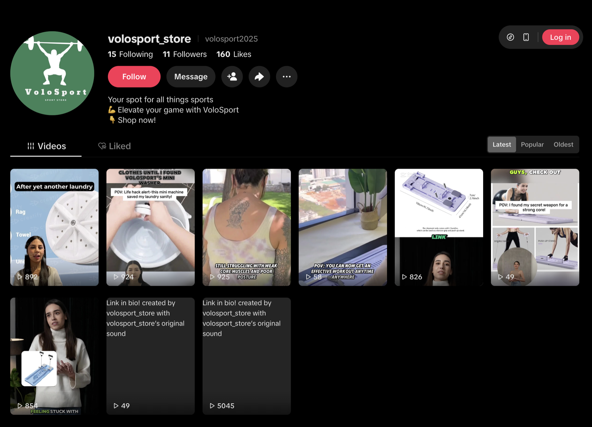
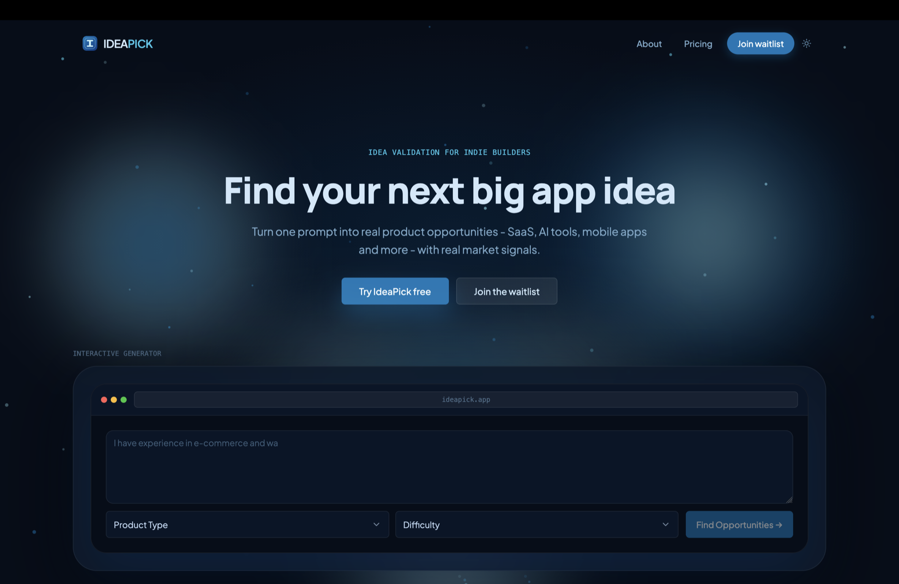
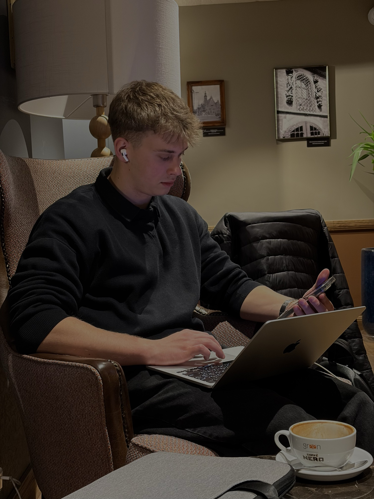

Until I was 16, I was certain I would play professional basketball. Not vaguely - specifically. I would live in LA, play in the NBA, and enjoy my life. I believed in myself, and I loved the sport.

Then in 2022 the war began, and my team collapsed. My family and I left for Truskavets, in the west of the country, and that was the end of playing seriously.

*The road out. 5 March 2022.*

I was still in school, still convinced I could go pro. But after several conversations with my parents, and a few with myself, I decided to try something else.

I am still not really sure why I dropped it. I was afraid of getting injured, afraid of not being good enough, and afraid that if it did not work out I would not be educated enough to do anything else. I knew plenty of people that had happened to.

Back then IT was popular, so I enrolled in a computer academy for a four-year software development course. We started with Python and I liked it - the thinking, the problem solving. Then we moved to C++ and whatever desire I had drained away. It was boring and it was hard.

I stopped paying attention in class and fell completely behind on homework. School was ending and I was playing basketball on the streets, and I had to decide who I was going to be.

I started looking at universities without any real wish to attend one. My thinking was that I just had to get in and figure it out from there, and leaving Ukraine altogether was going to happen sooner or later anyway. So I picked Business Informatics in Wrocław, on the grounds that it was at least adjacent to IT.

I arrived, met people, and did what everyone living away from home for the first time does: I partied almost every day. Clubs, alcohol, all of it. The academy fell away completely - about 40 overdue assignments by that point. I didn't care much. Something else would work out.

I did play a year for the university team in Wrocław. Nowhere near as serious as it had been in Ukraine, and I was not chasing anything this time.

Two or three times I tried to quit the academy, and every time my parents talked me out of it. By the end of first year the partying had stopped being fun. Not knowing what else to do, I started clawing my way back - not really learning, just grinding through the backlog of overdues. In parallel I was watching YouTube gurus on dropshipping, marketing, crypto. Obviously I needed to pick one and start making money. University turned out worse than the academy: endless Excel, analytics, and pointless business classes.

So dropshipping was going to be my way to the top. I picked a niche, built a store, bought a domain - sports goods - and nothing happened. The store needed promotion and advertising, and I didn't want to show my face, so I bought video clips for my products instead. They did nothing. I hunted for products, set up campaigns, fought with ad restrictions. It all led nowhere, and I dropped it.

*The store I built. It sold nothing.*

Around the same time the academy started on HTML and CSS. It wasn't difficult, so I poked at it a bit. I still had no idea what I was doing with my life.

Maybe travelling would help - this was the end of second year - so I travelled a fair amount with my girlfriend and thought about it. Nothing genuinely appealed to me, so I settled on the only thing left: learn web development properly and see what happens. After HTML and CSS came JavaScript, and it didn't disgust me. At the start of third year I decided I would be a frontend developer. The most popular and least needed profession in IT. What was I thinking.

With the basics and a few small projects, I started applying for jobs, and of course got no interviews. After three months I found one: junior frontend developer. Great, except it was unpaid. I didn't mind - I needed the experience. Six months there taught me an enormous amount: working in a team, using git properly, being disciplined. But I needed to earn money. I hoped they might offer me something. They didn't, so I left. It was the end of third year and I was defending my thesis.

The next search took about four months, and it went better because I finally had experience. I still failed interviews. I was rejected for no reason. I applied to positions that genuinely excited me and got automated rejection letters back. It was an awful stretch. The market is absolutely cooked, and plenty of companies wanted Polish, which I speak at a beginner level.

I got properly depressed and did not want to keep going with this shit. Then I thought: maybe this whole AI thing could work for me. Maybe I build my own AI SaaS.

So alongside the job hunting, I started looking for a problem worth solving. Building my own startup seemed like a good bet either way: if it failed I would have a serious project for my CV, and if it worked I would be on it full time and would not need a job at all. I went back and forth between a sports app, a tool for developers, and something in productivity. I asked friends what problems they actually had. Nobody gave me a clear answer. Since I could not come up with an idea myself, I decided to build an app that generates and validates ideas from real data - social media, forums, the App Store.

I began with a simple landing page and a waitlist, and started posting about it on X. With zero followers, most of those posts went into the void. That taught me quickly that distribution was going to be a much bigger problem than building. I ended up spending more time on social media than on the app itself, got better at it, and gained around 500 followers in a month. A few people signed up to the waitlist. I was thrilled, and it pushed me to keep going. I called the app IdeaPick, and between what I knew about software engineering and what Claude could do, I got a basic MVP working.

*The IdeaPick landing page, and the waitlist behind it.*

Then I realised it looked like a ChatGPT wrapper, and nobody was going to pay for that. In their position I would not have paid either. The project was not useful, and the numbers on X said the same thing.

All of this ran in parallel with the job search. I defended my bachelor thesis at both the university and the academy, so it was time to become an adult and get a real job. I put a lot of pressure on myself over that and got depressed again. My SaaS had come to nothing and I still had no job.

So I started the real LinkedIn grind. Texting recruiters every day, chasing paid internships, junior and middle roles. None of it worked. I was learning Polish seriously by then, because it improved my odds of an offer. Friends in other fields already had jobs, which added its own pressure. I started to think maybe IT was the wrong place to be looking, that AI meant nobody needed juniors any more.

I decided to stay and give it everything. Some interviews went really well, and then the answer came back that the position had been cancelled, or that they did not like my approach, or that my Polish was not good enough. Others went badly. I could not solve the problems or answer the questions. In other words - complete failure.

*April 2026. Still at it.*

But I am not giving up. This is still going on right now, and I am waiting on decisions from companies I would be glad to work for. The number one goal is still to become an entrepreneur and build a personal brand, and that is why I am writing this here. I hope this disgusting period of my life ends soon. And if you are reading this: don't you ever give up.
